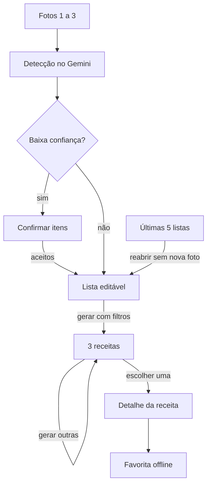

# ERS — App de Receitas com Visão Computacional

28/10/2026 · Miguel S. da Silva

## 1. Introdução

Esta ERS define o que o MVP do app deve fazer para levar o usuário da foto da geladeira a 3 receitas viáveis em menos de 30 segundos. Ela detalha o [TAP](TAP.md) de 25/10/2026 com as decisões tomadas na entrevista de 28/10/2026.

**Escopo.** App Android nativo, uso pessoal, sem backend próprio. Inclui captura de fotos, detecção de ingredientes com Gemini, lista editável, histórico das últimas listas, sugestão de receitas com filtros e favoritas offline. Login, iOS, controle de validade, lista de compras, nutrição e Play Store ficam fora.

**Definições**

| Termo | Significado |
| --- | --- |
| Lista | Conjunto de ingredientes que alimenta a geração de receitas |
| Item de baixa confiança | Ingrediente que a IA marcou com `confianca = baixa` |
| Ingrediente básico | Sal, açúcar, óleo, água; assumidos em casa |
| Faltante | Ingrediente da receita que não está na lista e não é básico |
| Favorita | Receita salva por completo no aparelho |

Referências: [TAP](TAP.md), [prompt de detecção](prompts/deteccao-ingredientes.md), wiki do repositório.

## 2. Descrição geral

O app é um cliente Android que chama o Gemini pelo Firebase AI Logic e guarda favoritas e histórico no Room. Não há servidor próprio nem conta de usuário.

**Usuário.** Uma pessoa (o próprio desenvolvedor), cozinhando em casa, em pt-BR, que quer decidir uma refeição rapidamente.

**Restrições**

- Android 8.0+ (minSdk 26), Kotlin, Jetpack Compose e Material 3
- Um desenvolvedor, cerca de 3 h por semana, orçamento próximo de zero
- Detecção e geração de receitas exigem internet
- Uso limitado ao plano gratuito do Gemini

**Premissas**

- Fotos com boa iluminação dão detecção aceitável
- A edição manual da lista compensa os erros do modelo
- A cota gratuita basta para uso pessoal, com as imagens reduzidas antes do envio

## 3. Requisitos funcionais

São 27 requisitos em seis módulos; prioridade **Alta** = necessário para o fluxo foto → lista → receitas.

Itens de baixa confiança só entram após confirmação; o histórico leva de volta à lista sem nova foto.

### 3.1 Captura de fotos

| ID | Requisito | Prioridade |
| --- | --- | --- |
| RF-01 | Permitir escolher fotos da galeria pelo Photo Picker do sistema | Alta |
| RF-02 | Permitir tirar foto com a câmera nativa do sistema (intent), sem CameraX | Alta |
| RF-03 | Aceitar de 1 a 3 fotos por detecção; bloquear a 4ª com aviso | Alta |
| RF-04 | Mostrar miniaturas das fotos escolhidas e permitir remover uma antes de enviar | Média |
| RF-05 | Descartar as fotos (arquivos temporários e URIs) ao fim da detecção, com sucesso ou erro | Alta |

### 3.2 Detecção de ingredientes

| ID | Requisito | Prioridade |
| --- | --- | --- |
| RF-06 | Redimensionar e comprimir cada foto antes do envio (ver RNF-05) | Alta |
| RF-07 | Enviar as fotos ao Gemini via Firebase AI Logic com o prompt versionado e schema JSON | Alta |
| RF-08 | Converter a resposta em itens com nome, quantidade opcional, categoria e confiança | Alta |
| RF-09 | Itens de confiança alta e média entram direto na lista | Alta |
| RF-10 | Itens de confiança baixa só entram após o usuário aceitar cada um em uma etapa de confirmação | Alta |
| RF-11 | Exibir a quantidade estimada quando houver; ela não influencia as receitas | Baixa |

### 3.3 Lista de ingredientes

| ID | Requisito | Prioridade |
| --- | --- | --- |
| RF-12 | Adicionar item por texto livre, com sugestões de nomes comuns ao digitar | Alta |
| RF-13 | Remover e editar o nome de qualquer item | Alta |
| RF-14 | Ao juntar resultados de nova detecção, não duplicar itens de mesmo nome (sem diferenciar maiúsculas e acentos) | Média |
| RF-15 | Agrupar ou ordenar os itens por categoria | Baixa |

### 3.4 Histórico de listas

| ID | Requisito | Prioridade |
| --- | --- | --- |
| RF-16 | Salvar automaticamente a lista usada ao gerar receitas | Média |
| RF-17 | Manter as 5 listas mais recentes; ao salvar a 6ª, apagar a mais antiga | Média |
| RF-18 | Reabrir uma lista do histórico para editar ou gerar receitas sem nova foto | Média |
| RF-19 | Permitir apagar uma lista do histórico | Baixa |

### 3.5 Receitas

| ID | Requisito | Prioridade |
| --- | --- | --- |
| RF-20 | Gerar 3 receitas a partir da lista, em JSON validado por schema | Alta |
| RF-21 | Filtrar por tempo de preparo, tipo de refeição e dificuldade antes de gerar | Média |
| RF-22 | Cada receita tem no máximo 3 faltantes; ingredientes básicos não contam | Alta |
| RF-23 | Botão "Gerar outras" pede 3 novas receitas sem repetir as já mostradas na sessão | Média |
| RF-24 | Detalhe mostra tempo, porções, dificuldade, ingredientes usados, faltantes destacados e passos numerados | Alta |

### 3.6 Favoritas

| ID | Requisito | Prioridade |
| --- | --- | --- |
| RF-25 | Favoritar e desfavoritar a partir do detalhe | Média |
| RF-26 | Salvar a receita completa no Room, aberta sem internet | Média |
| RF-27 | Tela de favoritas com lista e acesso ao detalhe | Média |

## 4. Requisitos não funcionais

| ID | Categoria | Requisito | Como verificar |
| --- | --- | --- | --- |
| RNF-01 | Desempenho | Da confirmação das fotos às 3 receitas em menos de 30 s, em Wi-Fi | Cronometrar 10 execuções |
| RNF-02 | Qualidade da IA | Detecção acerta ao menos 80% dos itens visíveis | Registro de testes com 30 fotos |
| RNF-03 | Privacidade | Nenhuma foto persiste no aparelho após a detecção; só os nomes dos itens são guardados | Inspecionar armazenamento do app |
| RNF-04 | Segurança | Chamadas à IA protegidas pelo App Check; nenhuma chave ou `google-services.json` no repositório | Revisão do PR e `.gitignore` |
| RNF-05 | Custo | Fotos redimensionadas (lado maior ≤ 1024 px) e comprimidas em JPEG antes do envio | Teste de unidade do redimensionamento |
| RNF-06 | Confiabilidade | Sem internet ou com erro da IA: mensagem clara, botão "Tentar de novo" e lista atual preservada | Teste em modo avião |
| RNF-07 | Disponibilidade offline | Favoritas e histórico abrem sem internet | Teste em modo avião |
| RNF-08 | Robustez | Resposta fora do schema não derruba o app; é tratada como erro (RNF-06) | Testes de unidade do parse |
| RNF-09 | Usabilidade | Interface em pt-BR; tema claro e escuro seguindo o sistema | Revisão visual |
| RNF-10 | Acessibilidade | `contentDescription` em imagens e ícones, alvos de toque ≥ 48 dp, texto em sp | Lint de acessibilidade |
| RNF-11 | Manutenibilidade | MVVM com repositório isolando IA e banco; prompts versionados em `docs/prompts/` | Revisão de código |
| RNF-12 | Qualidade de código | Lint, testes de unidade e build passando no GitHub Actions em todo PR | CI verde |

## 5. Dados e interface com a IA

O Room guarda duas entidades; fotos nunca são persistidas.

| Entidade | Campos | Regra |
| --- | --- | --- |
| ListaHistorico | id, criadaEm, itens (nome, categoria) | Máximo de 5; a mais antiga sai primeiro |
| ReceitaFavorita | id, titulo, tempoMin, porcoes, dificuldade, tipoRefeicao, usados, faltantes, passos, salvaEm | Receita completa, sem dependência de rede |

**Detecção (entrada → saída).** 1 a 3 imagens reduzidas → JSON conforme o schema de [`docs/prompts/deteccao-ingredientes.md`](prompts/deteccao-ingredientes.md): `ingredientes[]` com `nome`, `quantidade` (opcional), `categoria` e `confianca` (alta, media, baixa).

**Geração de receitas (entrada → saída).** Lista de nomes, filtros escolhidos e títulos já mostrados → JSON com `receitas[]` (exatamente 3), cada uma com:

- `titulo`, `tempoMin`, `porcoes`, `dificuldade` (facil, media, dificil), `tipoRefeicao` (cafe, almoco, jantar, lanche)
- `usados[]` e `faltantes[]` (no máximo 3, sem básicos)
- `passos[]` em ordem

O prompt de receitas ainda será criado no M4, em `docs/prompts/geracao-receitas.md`.

## 6. Rastreabilidade e aceite

O histórico de listas (RF-16 a RF-19) é a única adição ao plano do TAP e entra no M5, junto do Room.

| Marco | Requisitos | Aceite do marco |
| --- | --- | --- |
| M0 · Setup | RNF-02, RNF-04, RNF-12 | Prompt de detecção com ≥ 80% de acerto em 30 fotos; CI verde |
| M1 · Telas | RF-04, RF-12, RF-13, RF-24, RNF-09, RNF-10 | Fluxo navegável com dados falsos |
| M2 · Detecção | RF-01 a RF-03, RF-05 a RF-09, RF-11, RNF-03, RNF-05, RNF-08 | Foto real vira lista no aparelho |
| M3 · Lista | RF-10, RF-14, RF-15, RNF-06 | Várias fotos sem duplicar; confirmação de baixa confiança; erro recuperável |
| M4 · Receitas | RF-20 a RF-23, RNF-01 | 3 receitas com ≤ 3 faltantes em menos de 30 s |
| M5 · Favoritos e histórico | RF-16 a RF-19, RF-25 a RF-27, RNF-07 | Favoritas e últimas 5 listas abrem em modo avião |
| M6 · v1.0 | RNF-11, revisão geral | Critérios de sucesso do TAP atendidos; APK publicado |

## 7. Decisões da entrevista (28/10/2026)

| Tema | Decisão | Requisitos |
| --- | --- | --- |
| Captura | Galeria e câmera do sistema; CameraX fica fora do MVP | RF-01, RF-02 |
| Baixa confiança | Usuário confirma antes de o item entrar na lista | RF-10 |
| Quantidade | Opcional e só informativa | RF-11 |
| Fotos | Descartadas após a detecção | RF-05, RNF-03 |
| Adicionar item | Texto livre com sugestões | RF-12 |
| Filtros | Tempo, tipo de refeição e dificuldade; sem restrições alimentares | RF-21 |
| Faltantes | Até 3; básicos não contam | RF-22 |
| Receitas ruins | Botão "Gerar outras" | RF-23 |
| Detalhe | Metadados, usados e faltantes, passos; sem imagem | RF-24 |
| Favoritas | Receita completa offline | RF-26 |
| Histórico | Últimas 5 listas (novo em relação ao TAP) | RF-16 a RF-19 |
| Erros | Mensagem e tentar de novo, lista preservada | RNF-06 |
| Interface | pt-BR, tema claro e escuro | RNF-09 |
| Acessibilidade | Nível básico | RNF-10 |
| Cota | Reduzir imagem antes de enviar; sem limite diário | RNF-05 |
