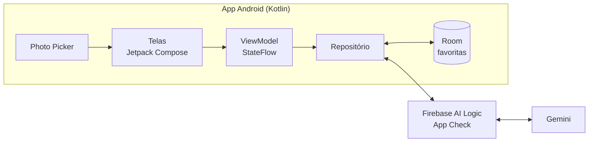
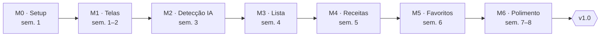

# TAP — App de Receitas com Visão Computacional

25/10/2026 · Miguel S. da Silva

## 1. Identificação

App Android que reconhece os itens da geladeira por foto e sugere receitas com o que há em casa. Projeto pessoal, desenvolvido por uma pessoa.

| Item | Valor |
| --- | --- |
| Nome | A definir (provisório: App de Receitas) |
| Tipo | Projeto pessoal |
| Responsável | Desenvolvedor único (dono do produto e dev) |
| Plataforma | Android nativo |
| Duração estimada | 4 a 8 semanas para o MVP |
| Repositório | [Miguel1138/visao\_computacional\_comida](https://github.com/Miguel1138/visao_computacional_comida) |

## 2. Justificativa

Decidir o que cozinhar com o que já está em casa toma tempo e leva a desperdício ou a pedir delivery. Listar ingredientes à mão é chato; uma foto resolve em segundos.

O projeto também serve para praticar Jetpack Compose, Firebase com Kotlin e integração com IA multimodal.

## 3. Objetivos

1. Identificar pelo menos 80% dos itens visíveis numa foto da geladeira, medido em 30 fotos de teste.
2. Ir da foto às sugestões de receita em menos de 30 segundos.
3. Sugerir 3 receitas viáveis usando principalmente itens detectados.
4. Publicar o MVP no próprio aparelho (APK de debug) em até 8 semanas.
5. Usar o app pelo menos 3 vezes por semana no primeiro mês.

## 4. Escopo

**Incluído no MVP**

- Tirar foto ou escolher da galeria (1 a 3 fotos)
- Detecção de ingredientes via Gemini, com retorno em JSON
- Lista de ingredientes editável (adicionar, remover, corrigir)
- Filtros simples: tempo de preparo e tipo de refeição
- Sugestão de 3 receitas com ingredientes usados e faltantes
- Salvar receitas favoritas localmente

**Fora do escopo (por enquanto)**

- Login e sincronização em nuvem
- iOS
- Controle de validade e estoque
- Lista de compras
- Informação nutricional detalhada
- Monetização e publicação na Play Store

## 5. Stack e arquitetura

App Android nativo em Kotlin, sem backend próprio: o app chama o Gemini pelo Firebase AI Logic e guarda os dados localmente.

| Camada | Tecnologia | Por quê |
| --- | --- | --- |
| UI | Jetpack Compose + Material 3 | Padrão atual do Android |
| Navegação | Navigation Compose | Poucas telas, simples |
| Arquitetura | MVVM (ViewModel + StateFlow) | Suficiente para um dev só |
| Câmera | Photo Picker no início; CameraX depois | Menos código no MVP |
| IA | Gemini via Firebase AI Logic | Sem backend; chave protegida pelo App Check |
| Serialização | kotlinx.serialization | Converter o JSON da IA |
| Banco local | Room | Favoritos e histórico |
| Injeção de dependência | Hilt (opcional) | Pode entrar depois |
| CI | GitHub Actions | Build e testes a cada PR |



A foto entra pelas telas, o repositório envia ao Gemini pelo Firebase e guarda as favoritas no Room.

## 6. Premissas e restrições

**Premissas**

- O plano gratuito do Gemini basta para uso pessoal
- Fotos com boa iluminação dão detecção aceitável
- A edição manual da lista compensa os erros do modelo

**Restrições**

- Um desenvolvedor, em tempo parcial
- Orçamento próximo de zero
- Requer internet para detectar e gerar receitas
- Curva de aprendizado de Compose no início

## 7. Riscos

| Risco | Impacto | Mitigação |
| --- | --- | --- |
| Detecção erra itens em potes ou embalagens | Alto | Lista editável; testar prompts no AI Studio antes |
| Receitas inventadas ou inviáveis | Médio | Prompt com regras claras; saída em schema JSON |
| Perder ritmo e abandonar o projeto | Alto | Entregas pequenas e semanais; MVP enxuto |
| Mudança de preço ou limite da API | Baixo | Camada de repositório isolando a IA |
| Compose demora a engrenar | Médio | Etapa 1 só com telas e dados falsos |

## 8. Critérios de sucesso

- [ ] Fluxo foto → lista → receitas funcionando de ponta a ponta no aparelho
- [ ] Detecção acerta 80% dos itens nas fotos de teste
- [ ] Pelo menos 1 receita sugerida preparada de fato por semana
- [ ] README com instruções de build e prints das telas

## 9. Plano de entregas

Sete marcos semanais levam à v1.0 em cerca de 8 semanas. Cada marco vira um milestone no GitHub, e cada item abaixo, uma issue.



M2 é o marco de maior risco: é quando a detecção real substitui os dados falsos.

### M0 · Setup e validação (semana 1)

- [ ] Criar repositório com README, licença e .gitignore do Android
- [ ] Criar projeto Android (Compose, minSdk 26, Kotlin DSL)
- [ ] Configurar GitHub Actions com build e lint
- [ ] Testar o prompt de detecção no Google AI Studio com 30 fotos

### M1 · Telas com dados falsos (semanas 1 e 2)

- [ ] Tela inicial com botão de foto
- [ ] Tela de lista de ingredientes
- [ ] Tela de receitas sugeridas
- [ ] Tela de detalhe da receita
- [ ] Navegação entre telas com Navigation Compose

### M2 · Detecção com IA (semana 3)

- [ ] Configurar Firebase e App Check
- [ ] Integrar Photo Picker
- [ ] Enviar foto ao Gemini via Firebase AI Logic
- [ ] Definir schema JSON dos ingredientes e fazer o parse

### M3 · Lista editável (semana 4)

- [ ] Adicionar, remover e editar ingredientes
- [ ] Juntar resultados de várias fotos sem duplicar itens
- [ ] Estados de carregamento e erro

### M4 · Receitas (semana 5)

- [ ] Prompt de geração de receitas com schema JSON
- [ ] Filtros de tempo e tipo de refeição
- [ ] Destacar ingredientes faltantes

### M5 · Favoritos (semana 6)

- [ ] Configurar Room
- [ ] Salvar e remover favoritas
- [ ] Tela de favoritas

### M6 · Polimento e v1.0 (semanas 7 e 8)

- [ ] Revisar UX e textos
- [ ] Testes de unidade nos ViewModels e no parse
- [ ] Ícone e tela de abertura
- [ ] Gerar release v1.0 com APK no GitHub

## 10. Organização do repositório

Fluxo simples para um dev só: `main` sempre compilando, uma branch por issue e PR para registrar o histórico.

**Estrutura de pastas**

```
/
├── app/                  # Código do app Android
├── docs/
│   ├── TAP.md            # Este documento
│   └── prompts/          # Prompts do Gemini versionados
├── .github/
│   ├── workflows/        # CI (build e lint)
│   └── ISSUE_TEMPLATE/   # Modelos de issue
└── README.md
```

**Convenções**

| Item | Padrão |
| --- | --- |
| Branches | `feat/<issue>-descricao`, `fix/<issue>-descricao` |
| Commits | Conventional Commits (`feat:`, `fix:`, `docs:`, `chore:`) |
| Labels | `feature`, `bug`, `ui`, `ia`, `infra`, `docs` |
| Milestones | M0 a M6, como na seção 9 |
| Board | GitHub Projects com colunas A fazer, Fazendo, Feito |
| Versões | Tags semânticas (`v0.1.0` por marco, `v1.0.0` no fim) |

**Arquivos que nunca vão para o repo:** `google-services.json` e qualquer chave. Adicione ao `.gitignore`.
