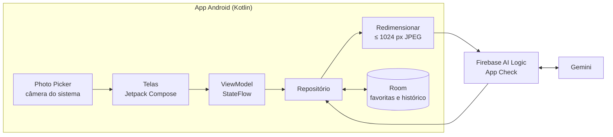

# Arquitetura

App Android nativo em Kotlin (minSdk 26), sem backend próprio: o app chama o Gemini pelo Firebase AI Logic e guarda os dados localmente.

| Camada | Tecnologia | Por quê |
| --- | --- | --- |
| UI | Jetpack Compose + Material 3 | Padrão atual do Android; tema claro e escuro do sistema |
| Navegação | Navigation Compose | Poucas telas, simples |
| Arquitetura | MVVM (ViewModel + StateFlow) | Suficiente para um dev só; repositório isola IA e banco |
| Captura | Photo Picker + câmera do sistema (intent) | Sem CameraX no MVP |
| Imagem | Redimensionar (lado maior ≤ 1024 px) e JPEG antes do envio | Cabe na cota gratuita |
| IA | Gemini via Firebase AI Logic | Sem backend; chave protegida pelo App Check |
| Serialização | kotlinx.serialization | Converter o JSON da IA; fora do schema vira erro |
| Banco local | Room | Favoritas e histórico das últimas 5 listas, offline |
| Injeção de dependência | Hilt (opcional) | Pode entrar depois |
| CI | GitHub Actions | Lint, testes e build a cada PR |

A foto entra pelas telas, é reduzida e enviada ao Gemini pelo Firebase; depois da detecção ela é descartada. O Room guarda só nomes de itens e receitas.

## Dados locais

| Entidade | Campos | Regra |
| --- | --- | --- |
| ListaHistorico | id, criadaEm, itens (nome, categoria) | Máximo de 5; a mais antiga sai primeiro |
| ReceitaFavorita | id, titulo, tempoMin, porcoes, dificuldade, tipoRefeicao, usados, faltantes, passos, salvaEm | Receita completa, sem dependência de rede |

Fotos nunca são persistidas (RNF-03).

## Interface com a IA

| Chamada | Entrada | Saída |
| --- | --- | --- |
| Detecção | 1 a 3 imagens reduzidas | `ingredientes[]`: `nome`, `quantidade` (opcional), `categoria`, `confianca` (alta, media, baixa) |
| Receitas | Nomes da lista, filtros, títulos já mostrados | `receitas[]` (exatamente 3): `titulo`, `tempoMin`, `porcoes`, `dificuldade`, `tipoRefeicao`, `usados[]`, `faltantes[]` (≤ 3), `passos[]` |

Os prompts estão em [[Prompts]].
