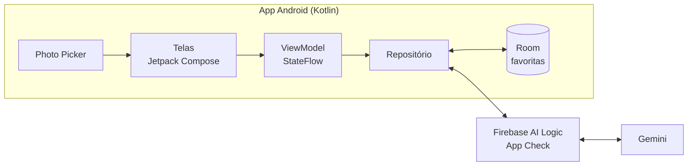

# Arquitetura

App Android nativo em Kotlin, sem backend próprio: o app chama o Gemini pelo Firebase AI Logic e guarda os dados localmente.

| Camada | Tecnologia | Por quê |
| --- | --- | --- |
| UI | Jetpack Compose + Material 3 | Padrão atual do Android |
| Navegação | Navigation Compose | Poucas telas, simples |
| Arquitetura | MVVM (ViewModel + StateFlow) | Suficiente para um dev só |
| Câmera | Photo Picker no início; CameraX depois | Menos código no MVP |
| IA | Gemini via Firebase AI Logic | Sem backend; chave protegida pelo App Check |
| Serialização | kotlinx.serialization | Converter o JSON da IA |
| Banco local | Room | Favoritos e histórico |
| Injeção de dependência | Hilt (opcional) | Pode entrar depois |
| CI | GitHub Actions | Build e testes a cada PR |

A foto entra pelas telas, o repositório envia ao Gemini pelo Firebase e guarda as favoritas no Room.
