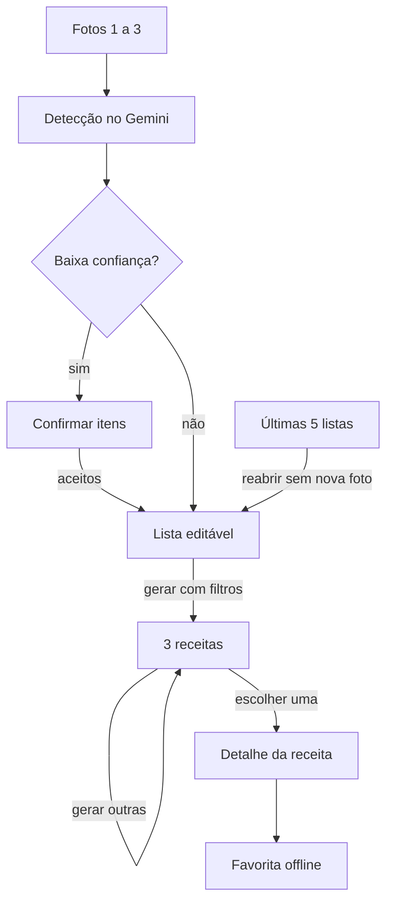

# Requisitos

Resumo da [ERS completa](https://github.com/Miguel1138/visao_computacional_comida/blob/main/docs/ERS.md) (28/10/2026): 27 requisitos funcionais (RF) e 12 não funcionais (RNF). Cada issue cita os IDs que entrega.

## Funcionais

| Módulo | IDs | Resumo |
| --- | --- | --- |
| Captura | RF-01 a RF-05 | Galeria (Photo Picker) e câmera do sistema; 1 a 3 fotos com miniaturas; fotos descartadas após a detecção |
| Detecção | RF-06 a RF-11 | Reduzir a foto, enviar ao Gemini, converter o JSON; baixa confiança só entra após confirmação; quantidade só informativa |
| Lista | RF-12 a RF-15 | Adicionar por texto com sugestões, editar, remover; juntar sem duplicar (ignora maiúsculas e acentos); agrupar por categoria |
| Histórico | RF-16 a RF-19 | Últimas 5 listas salvas ao gerar receitas; reabrir sem nova foto; apagar |
| Receitas | RF-20 a RF-24 | 3 receitas em JSON; filtros de tempo, refeição e dificuldade; até 3 faltantes (básicos não contam); "Gerar outras"; detalhe completo |
| Favoritas | RF-25 a RF-27 | Favoritar no detalhe; receita completa offline; tela de favoritas |

**Ingredientes básicos** (não contam como faltantes): sal, açúcar, óleo, água.

## Não funcionais

| ID | Requisito |
| --- | --- |
| RNF-01 | Da confirmação das fotos às 3 receitas em < 30 s (Wi-Fi) |
| RNF-02 | Detecção acerta ≥ 80% dos itens em 30 fotos |
| RNF-03 | Nenhuma foto persiste após a detecção |
| RNF-04 | App Check; nenhuma chave no repositório |
| RNF-05 | Fotos com lado maior ≤ 1024 px, em JPEG |
| RNF-06 | Erro ou sem internet: mensagem, "Tentar de novo", lista preservada |
| RNF-07 | Favoritas e histórico abrem offline |
| RNF-08 | Resposta fora do schema vira erro, sem crash |
| RNF-09 | pt-BR; tema claro e escuro do sistema |
| RNF-10 | `contentDescription`, toque ≥ 48 dp, texto em sp |
| RNF-11 | MVVM com repositório isolando IA e banco; prompts versionados |
| RNF-12 | Lint, testes e build verdes no CI em todo PR |

## Rastreabilidade

| Marco | Requisitos | Aceite |
| --- | --- | --- |
| M0 · Setup | RNF-02, RNF-04, RNF-12 | Prompt com ≥ 80% em 30 fotos; CI verde |
| M1 · Telas | RF-04, RF-12, RF-13, RF-24, RNF-09, RNF-10 | Fluxo navegável com dados falsos |
| M2 · Detecção | RF-01 a RF-03, RF-05 a RF-09, RF-11, RNF-03, RNF-05, RNF-08 | Foto real vira lista no aparelho |
| M3 · Lista | RF-10, RF-14, RF-15, RNF-06 | Várias fotos sem duplicar; confirmação; erro recuperável |
| M4 · Receitas | RF-20 a RF-23, RNF-01 | 3 receitas com ≤ 3 faltantes em < 30 s |
| M5 · Favoritos e histórico | RF-16 a RF-19, RF-25 a RF-27, RNF-07 | Favoritas e últimas 5 listas em modo avião |
| M6 · v1.0 | RNF-11, revisão geral | Critérios de sucesso do TAP; APK publicado |
