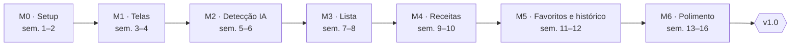

# Roadmap

Sete marcos levam à v1.0 em cerca de 16 semanas, a 3 h por semana. Cada marco é um [milestone](https://github.com/Miguel1138/visao_computacional_comida/milestones) e cada item, uma [issue](https://github.com/Miguel1138/visao_computacional_comida/issues). Os IDs entre parênteses vêm da [[ERS|Requisitos]].

M2 é o marco de maior risco: é quando a detecção real substitui os dados falsos. Em relação ao TAP, a ERS moveu a edição da lista para o M1 e acrescentou o histórico de listas ao M5.

### M0 · Setup e validação (semanas 1 e 2)

Aceite: prompt de detecção com ≥ 80% de acerto em 30 fotos; CI verde.

- [x] Criar repositório com README, licença e .gitignore do Android
- [ ] Criar projeto Android (Compose, minSdk 26, Kotlin DSL)
- [ ] Ativar build, lint e testes no GitHub Actions (RNF-04, RNF-12)
- [ ] Testar prompt de detecção no AI Studio com 30 fotos (RNF-02)

### M1 · Telas com dados falsos (semanas 3 e 4)

Aceite: fluxo navegável com dados falsos.

- [ ] Tela inicial com galeria, câmera e miniaturas das fotos (RF-04)
- [ ] Tela de lista de ingredientes
- [ ] Adicionar item por texto com sugestões, editar e remover (RF-12, RF-13)
- [ ] Tela de receitas sugeridas
- [ ] Tela de detalhe da receita (RF-24)
- [ ] Navegação entre telas com Navigation Compose
- [ ] Tema claro e escuro e textos em pt-BR (RNF-09)
- [ ] Acessibilidade básica (RNF-10)

### M2 · Detecção com IA (semanas 5 e 6)

Aceite: foto real vira lista no aparelho.

- [ ] Configurar Firebase e App Check (RNF-04)
- [ ] Escolher fotos pela galeria e pela câmera do sistema, de 1 a 3 (RF-01 a RF-03)
- [ ] Redimensionar e comprimir fotos antes do envio (RF-06, RNF-05)
- [ ] Enviar fotos ao Gemini via Firebase AI Logic (RF-07)
- [ ] Converter a resposta do Gemini em itens da lista (RF-08, RF-09, RF-11, RNF-08)
- [ ] Descartar as fotos ao fim da detecção (RF-05, RNF-03)

### M3 · Lista editável (semanas 7 e 8)

Aceite: várias fotos sem duplicar; confirmação de baixa confiança; erro recuperável.

- [ ] Confirmar itens de baixa confiança antes de entrarem na lista (RF-10)
- [ ] Juntar resultados de várias fotos sem duplicar itens (RF-14)
- [ ] Agrupar itens por categoria (RF-15)
- [ ] Estados de carregamento e erro com "Tentar de novo" (RNF-06)

### M4 · Receitas (semanas 9 e 10)

Aceite: 3 receitas com ≤ 3 faltantes em menos de 30 s.

- [ ] Prompt de geração de receitas com schema JSON (RF-20)
- [ ] Filtros de tempo, tipo de refeição e dificuldade (RF-21)
- [ ] Limitar a 3 faltantes e destacá-los (RF-22)
- [ ] Botão "Gerar outras" sem repetir receitas (RF-23)
- [ ] Medir o tempo da foto às receitas (RNF-01)

### M5 · Favoritos e histórico (semanas 11 e 12)

Aceite: favoritas e últimas 5 listas abrem em modo avião.

- [ ] Configurar Room com favoritas e histórico (RNF-07)
- [ ] Favoritar e desfavoritar receitas (RF-25, RF-26)
- [ ] Tela de favoritas (RF-27)
- [ ] Salvar automaticamente as últimas 5 listas (RF-16, RF-17)
- [ ] Tela de histórico: reabrir e apagar listas (RF-18, RF-19)

### M6 · Polimento e v1.0 (semanas 13 a 16)

Aceite: critérios de sucesso do TAP atendidos; APK publicado.

- [ ] Revisar UX e textos
- [ ] Testes de unidade nos ViewModels, no parse e no redimensionamento (RNF-11)
- [ ] Ícone e tela de abertura
- [ ] Gerar release v1.0 com APK no GitHub
