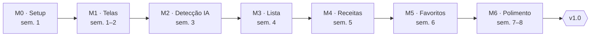

# Roadmap

Sete marcos semanais levam à v1.0 em cerca de 8 semanas. Cada marco é um [milestone](https://github.com/Miguel1138/visao_computacional_comida/milestones) e cada item, uma [issue](https://github.com/Miguel1138/visao_computacional_comida/issues).

M2 é o marco de maior risco: é quando a detecção real substitui os dados falsos.

### M0 · Setup e validação (semana 1)

- [ ] Criar repositório com README, licença e .gitignore do Android
- [ ] Criar projeto Android (Compose, minSdk 26, Kotlin DSL)
- [ ] Configurar GitHub Actions com build e lint
- [ ] Testar o prompt de detecção no Google AI Studio com 30 fotos

### M1 · Telas com dados falsos (semanas 1 e 2)

- [ ] Tela inicial com botão de foto
- [ ] Tela de lista de ingredientes
- [ ] Tela de receitas sugeridas
- [ ] Tela de detalhe da receita
- [ ] Navegação entre telas com Navigation Compose

### M2 · Detecção com IA (semana 3)

- [ ] Configurar Firebase e App Check
- [ ] Integrar Photo Picker
- [ ] Enviar foto ao Gemini via Firebase AI Logic
- [ ] Definir schema JSON dos ingredientes e fazer o parse

### M3 · Lista editável (semana 4)

- [ ] Adicionar, remover e editar ingredientes
- [ ] Juntar resultados de várias fotos sem duplicar itens
- [ ] Estados de carregamento e erro

### M4 · Receitas (semana 5)

- [ ] Prompt de geração de receitas com schema JSON
- [ ] Filtros de tempo e tipo de refeição
- [ ] Destacar ingredientes faltantes

### M5 · Favoritos (semana 6)

- [ ] Configurar Room
- [ ] Salvar e remover favoritas
- [ ] Tela de favoritas

### M6 · Polimento e v1.0 (semanas 7 e 8)

- [ ] Revisar UX e textos
- [ ] Testes de unidade nos ViewModels e no parse
- [ ] Ícone e tela de abertura
- [ ] Gerar release v1.0 com APK no GitHub
